# Federated RGB-X Tracking with Group-Specific Prompt Aggregation

Code for **Fed-MAPTrack**: prompt-based federated RGB-X tracking built on the frozen
[ViPT](https://github.com/jiawen-zhu/ViPT) tracker. Only ViPT's prompt parameters are trained and exchanged
(about 0.84 M of 93 M parameters). Twelve simulated clients hold RGB-T (LasHeR), RGB-D (DepthTrack) and RGB-E (VisEvent)
videos; one client per dataset has no auxiliary sensor (RGB-only). The server keeps each group of prompt parameters
in the aggregation domain that fits its role:

| group | what it consumes | tensors (params) |
|---|---|---|
| `aux_specific` | the auxiliary modality (thermal / depth / event) | 664,416 |
| `rgb_shared` | the RGB half | 73,836 |
| `fusion` | the fused RGB + auxiliary features | 82,944 |
| `norm` | normalisation shared by construction | 18,432 |

This repository also contains the federated baselines used in the paper's comparison, so that every row can be rerun
from one code base.

> This is a research code base, forked from [ViPT](https://github.com/jiawen-zhu/ViPT) (MIT licence, see `LICENSE`).
> Only what the federated experiments need is kept: the tracker model, ViPT's data loading and loss, the federated layer
> in `lib/federated/`, and the scripts that evaluate the trained checkpoints. ViPT's own centralised training scripts,
> demo material and other benchmarks' tooling were removed; use the ViPT repository for those.

## Method at a glance

<p align="center">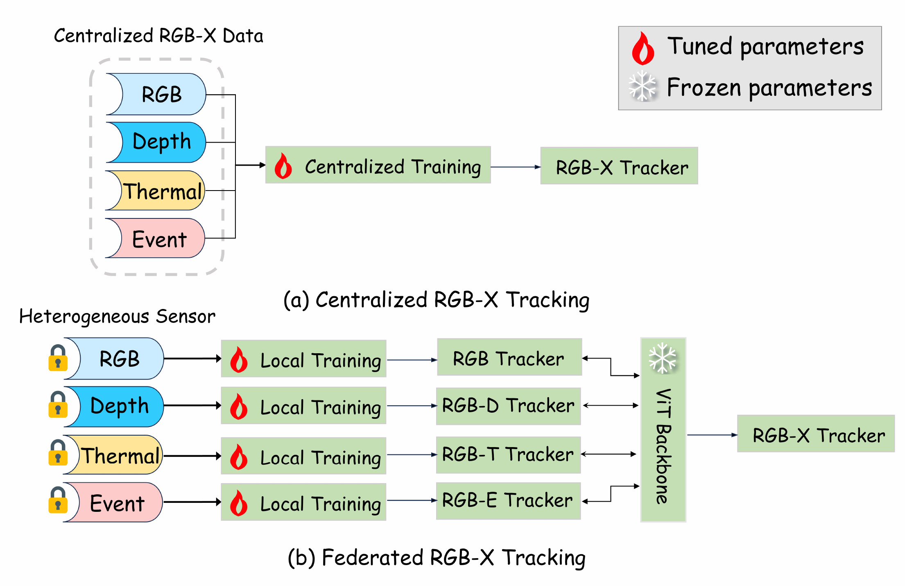</p>

*Motivation of federated RGB-X tracking. (a) Centralized RGB-X tracking pools aligned data from all sensors for one training run. (b) In the federated setting, clients with different sensors (RGB, depth, thermal, event) train locally, and only the tuned prompt parameters are aggregated on top of a frozen ViT backbone.* ([PDF](assets/figures/pdf/motivation.pdf))

<p align="center">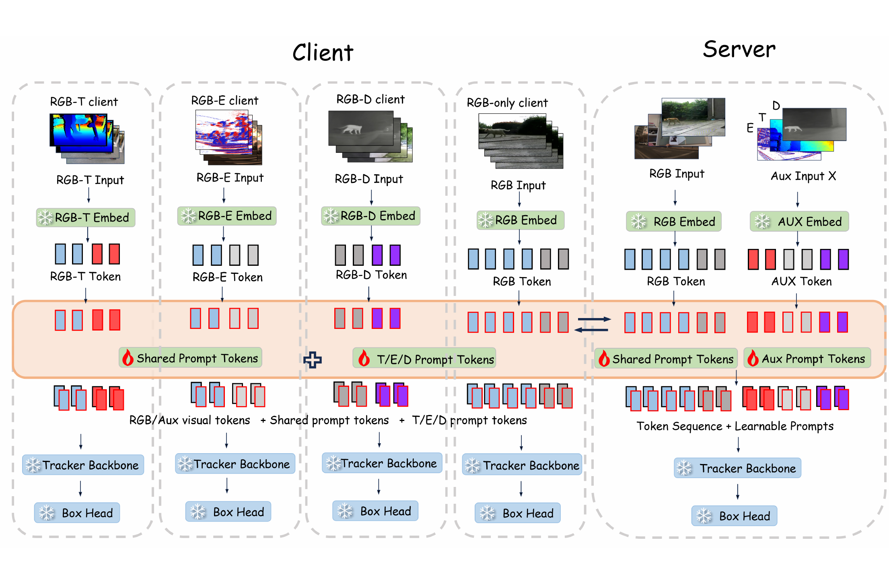</p>

*Overall framework of Fed-MAPTrack. Clients keep training videos local and adapt prompt-related parameters on a frozen tracking backbone and prediction head. RGB-shared parameters use one global bank, while auxiliary-specific, fusion, and normalization parameters use modality banks. Server aggregation combines this sharing structure with sensor-dependent contributor eligibility.* ([PDF](assets/figures/pdf/framework.pdf))

<p align="center">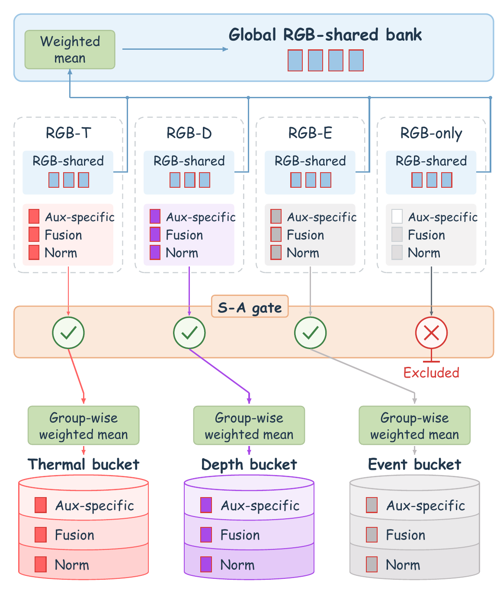</p>

*Unified aggregation design. RGB-shared parameters use the global bank, while auxiliary-specific, fusion, and normalization parameters use thermal, depth, and event banks. The participation gate retains valid RGB updates from RGB-only clients but excludes their modality-related contributions from server bucket averages. Dispatch and local trainability are distinct from server eligibility.* ([PDF](assets/figures/pdf/aggregation_details.pdf))

## What is where

| path | content |
|---|---|
| `lib/federated/server.py` | the federated server: variants, rounds, aggregation, checkpoint export |
| `lib/federated/client.py` | one client's local training (uses ViPT's official actor and loss, unchanged) |
| `lib/federated/aggregator.py` | mask-aware, group-aware aggregation (rules R1-R6 are documented in the file) |
| `lib/federated/param_groups.py` | which tensor belongs to which group |
| `lib/federated/personalized.py` | aggregation maths of the FedMSplit-P and FED-PRIME baselines |
| `lib/federated/test_*.py` | unit tests (plain scripts, no pytest needed) |
| `configs/fed/client_splits/` | the client partition used in the paper (`..._seed42_v2.json`) |
| `scripts/eval/` | evaluation helpers (LasHeR scorer, VisEvent scorer) |
| `scripts/supp/` | builds the DepthTrack-only partitions of the sensitivity / centralised-reference runs |
| `docs/` | how the two newest baselines are adapted, and how this tree was merged from the development branches |
| `experiments/vipt/` | ViPT configs; `deep_*_prime.yaml` are the configs for FED-PRIME checkpoints |

## Variants (`--variant`)

| row in the paper's Table 1 | command-line arguments |
|---|---|
| Local | `--variant local` |
| FedAvg | `--variant fedavg` |
| FedProx | `--variant fedprox --prox-mu 0.01` |
| FedPer | `--variant fedper` |
| Ditto | `--variant ditto --ditto-lambda 0.1` |
| FedMSplit-P | `--variant fedmsplit_p` |
| FED-PRIME | `--variant fedprime` |
| Independent FL | `--variant modality --clients <the four clients of one dataset>` (one run per dataset) |
| Fed-MAPTrack (aux-specific buckets only) | `--variant modality` |
| Fed-MAPTrack (all three groups bucketed, RGB-only clients participate) | `--variant modality --bucket-groups aux_specific,fusion,norm` |
| **Fed-MAPTrack** (selective participation, the final method) | `--variant modality --bucket-groups aux_specific,fusion,norm --selective-participation` |

Common arguments of every reported run: `--rounds 120 --local-steps 50 --workers 0 --clients-per-round 1.0
--save-every 20 --export-at-end`, seeds 42 / 0 / 123.

FedMSplit-P and FED-PRIME are the prompt-tuning baselines of Phung et al. (ICCV 2025), adapted from image-text
classification to ViPT. They are adapted references, not exact reproductions; every deviation from the original method
is listed in `docs/NEW_BASELINES.md`.

## Results

All numbers are mean ± sample standard deviation over three seeds (42, 0, 123) at communication round 120, one fixed
client partition (Dirichlet alpha = 0.5), as in the paper. For the methods marked *client models* each seed first averages
the scores of the benchmark's three sensor-equipped client models. Bold = best mean in the column.

### Main comparison

| Method | Category | LasHeR (RGB-T) AUC (%) | VisEvent (RGB-E) SR (%) | DepthTrack (RGB-D) F-score (%) |
|---|---|---|---|---|
| Local (*client models*) | Local training | 47.34 ± 0.31 | 52.27 ± 0.25 | 49.91 ± 1.46 |
| FedAvg | Standard FL | 46.55 ± 0.99 | 52.93 ± 0.59 | 53.85 ± 0.73 |
| FedProx | Standard FL | 46.78 ± 0.67 | 53.11 ± 0.66 | 54.06 ± 0.64 |
| FedPer (*client models*) | Personalized FL | 47.35 ± 0.54 | 54.47 ± 0.36 | 50.81 ± 0.68 |
| Ditto (*client models*) | Personalized FL | 46.46 ± 0.86 | 54.14 ± 0.42 | 53.90 ± 0.58 |
| FedMSplit-P (*client models*) | Multimodal FL | 46.43 ± 0.33 | 54.85 ± 0.35 | 54.24 ± 0.89 |
| FED-PRIME (*client models*) | Multimodal FL | 46.78 ± 0.45 | 52.09 ± 0.26 | 54.32 ± 0.17 |
| Independent FL | Separate FL | 48.25 ± 0.65 | **56.45 ± 0.83** | 55.28 ± 1.35 |
| **Fed-MAPTrack** (ours) | Ours | **48.90 ± 0.63** | 56.38 ± 0.41 | **55.96 ± 0.50** |

FedMSplit-P and FED-PRIME are adapted references, see [`docs/NEW_BASELINES.md`](docs/NEW_BASELINES.md).

### Ablation of the aggregation design

| Variant | Auxiliary bucket | Fusion/Norm bucket | Selective participation | RGB-T AUC (%) | RGB-E SR (%) | RGB-D F-score (%) |
|---|:-:|:-:|:-:|---|---|---|
| FedAvg | | | | 46.55 ± 0.99 | 52.93 ± 0.59 | 53.85 ± 0.73 |
| Auxiliary-only bucketing | x | | | 47.47 ± 1.24 | **56.46 ± 0.37** | **56.02 ± 0.32** |
| Extended bucketing without selective participation (FNA) | x | x | | 43.70 ± 0.95 | 54.21 ± 0.27 | 55.31 ± 0.57 |
| **Fed-MAPTrack** | x | x | x | **48.90 ± 0.63** | 56.38 ± 0.41 | 55.96 ± 0.50 |

RGB-shared parameters are globally aggregated in all four configurations. FNA and Fed-MAPTrack have the same bucketing
scope and differ only in the participation rule. Command lines for every row are in the table under *Variants*.

### Partition sensitivity and centralised reference (DepthTrack only, one seed)

DepthTrack F-score (%), seed 42, a federation of only the four DepthTrack clients (3 depth sensors + 1 RGB-only), alpha =
Dirichlet concentration of the sequence partition (smaller = more skewed). One training run per cell.

| Method | alpha = 0.1 | alpha = 0.5 | alpha = 1.0 |
|---|---|---|---|
| FedAvg | 53.81 | 54.02 (a) / 56.83 (b) | 57.38 |
| Fed-MAPTrack | 54.93 | 55.47 | 53.86 |
| Centralised reference (one client, all 146 training sequences, same total number of steps) | 57.40 | | |

(a) the independent-FL run from the main comparison (equivalent to FedAvg in a single-modality federation), trained on an
RTX 4090. (b) the same configuration rerun on the RTX 4080 SUPER that trained all other cells of this table. The two differ
by 2.81 points for the same configuration, more than the three-seed standard deviations above (0.5-1.4), so differences of
about three points or less in this single-seed table should not be interpreted. The share of RGB-only data in the
four-client federation changes with alpha (0.5%, 3.0% and 38.5% of the frames for alpha = 0.1, 0.5 and 1.0).

### More figures

<p align="center">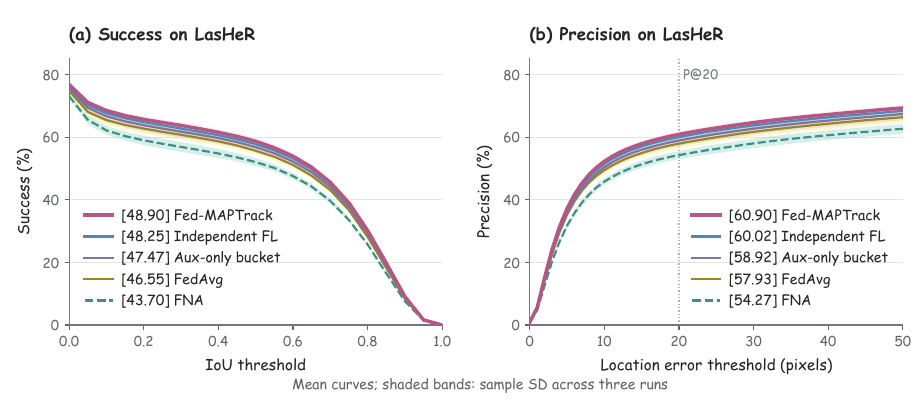</p>

*Success and precision curves on LasHeR at communication round 120 using the same 245 test sequences. Curves show means across three training repetitions, and shaded bands indicate sample standard deviations. Legend values are success AUC in (a) and precision at a 20-pixel threshold in (b), expressed as percentages. Auxiliary-only bucketing and FNA are included as controlled aggregation variants.* ([PDF](assets/figures/pdf/lasher_tracking_curves.pdf))

<p align="center">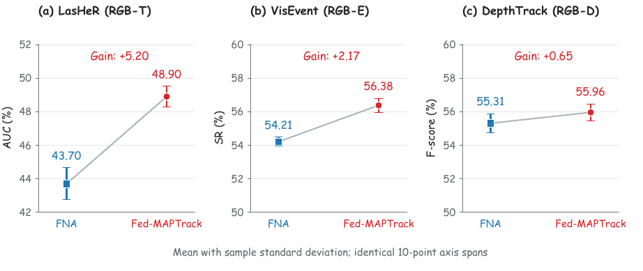</p>

*Effect of selective participation with the parameter-group bucketing scope held fixed. Blue squares and red circles show the mean scores of FNA and Fed-MAPTrack, respectively; error bars indicate sample standard deviations over three training repetitions. The mean gains are 5.20 AUC points on LasHeR, 2.17 SR points on VisEvent, and 0.65 F-score points on DepthTrack. Each vertical axis spans ten percentage points. Connecting lines indicate changes between aggregate means, rather than individual-run trajectories.* ([PDF](assets/figures/pdf/fna_to_fedmaptrack_transition.pdf))

<p align="center">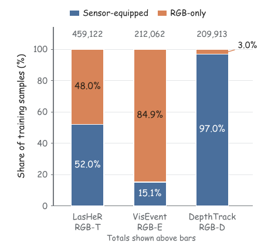</p>

*Training-sample composition of sensor-equipped and RGB-only clients under the evaluated partition. Totals are shown above the bars. RGB-only samples account for 48.0%, 84.9%, and 3.0% of LasHeR, VisEvent, and DepthTrack, respectively. Each benchmark has three sensor-equipped clients and one RGB-only client; the bars describe data proportions rather than client-count proportions.* ([PDF](assets/figures/pdf/rgb_only_bucket_composition.pdf))

<p align="center">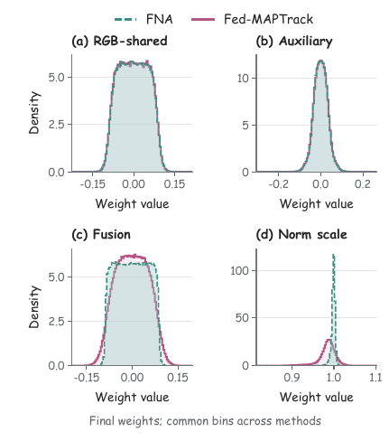</p>

*Empirical final weight distributions of FNA and Fed-MAPTrack at communication round 120. RGB-shared weights use the global bank; the other groups pool the three active modality banks. Curves average three per-run densities using common histogram bins covering the full observed range. Biases, scalar fovea parameters, stored initial banks, and inactive global modality banks are excluded. Panel (d) shows normalization scale weights. These are final-state distributions, not changes from initialization.* ([PDF](assets/figures/pdf/prompt_weight_distributions.pdf))

<p align="center">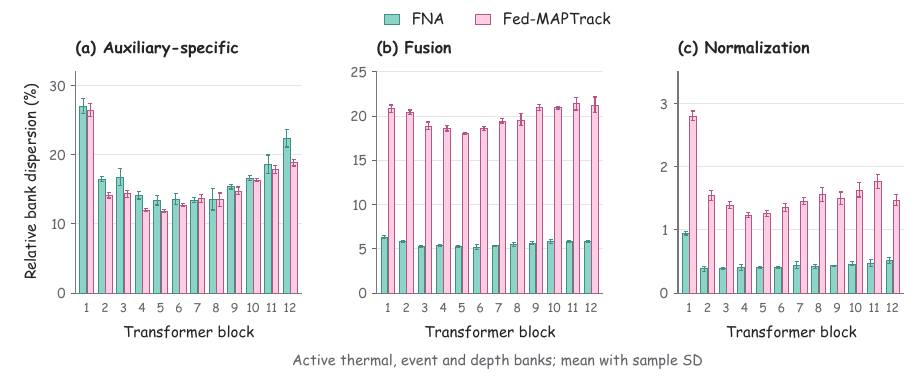</p>

*Layer-wise separation of final thermal, event, and depth parameter banks, measured by the relative dispersion in Eq.. All parameters, including biases, are included within each group and Transformer block. Bars and error bars show the mean and sample standard deviation across three training repetitions. The RGB-shared group has only one bank and is omitted. Each panel starts at zero but uses its own labeled range. The statistic describes final bank separation, not tracking accuracy or changes from initialization.* ([PDF](assets/figures/pdf/prompt_bank_dispersion.pdf))

<p align="center">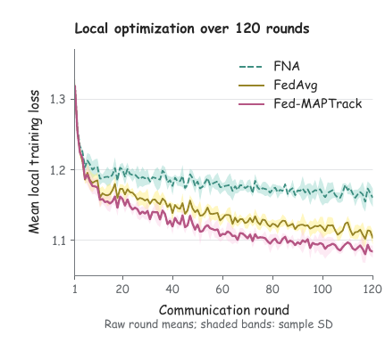</p>

*Recorded local training loss over 120 communication rounds. Within each repetition, the twelve clients' mean local losses are averaged equally in each round. Curves and shaded bands then show the mean and sample standard deviation across three repetitions. All recorded rounds are plotted without smoothing or interpolation. The figure describes local optimization, not intermediate-round benchmark performance.* ([PDF](assets/figures/pdf/federated_training_loss.pdf))

<p align="center">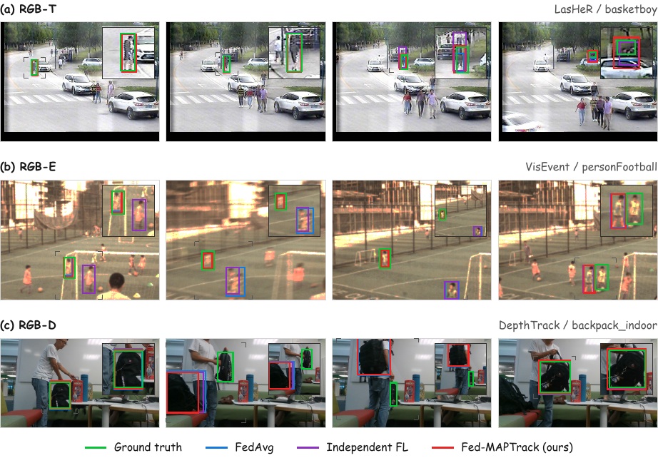</p>

*Qualitative RGB-X tracking comparisons on (a) LasHeR, (b) VisEvent, and (c) DepthTrack. Green, blue, purple, and red solid boxes indicate ground truth, FedAvg, Independent FL, and Fed-MAPTrack, respectively. Each row shows temporally ordered frames from one sequence. Insets magnify a common region containing all displayed predictions and the ground truth; gray corner markers identify these regions in the full images. The examples include both accurate localization and tracking failures.* ([PDF](assets/figures/pdf/qualitative_tracking.pdf))

<p align="center">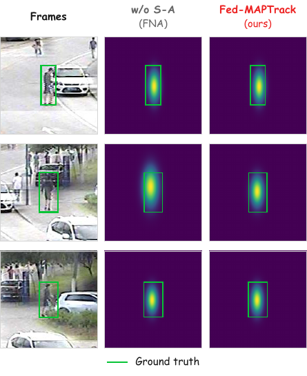</p>

*Box-derived localization comparison between FNA and Fed-MAPTrack on basketboy. The first column shows reference RGB crops; the remaining columns encode saved predicted boxes using the same elliptical Gaussian centered at each predicted box center, with standard deviations equal to one quarter of the predicted width and height. Green boxes indicate ground truth in the common crop coordinates. The maps visualize bounding-box location and extent, rather than internal model attention or confidence.* ([PDF](assets/figures/pdf/box_localization_comparison.pdf))

## Setup

1. Install the ViPT environment (`install_vipt.sh`, PyTorch 2.5.1 / CUDA 12.4 was used).
2. Download the pretrained foundation tracker (OSTrack, file `OSTrack_ep0300.pth.tar`) from the
   [ViPT release folder](https://drive.google.com/drive/folders/1ttafo0O5S9DXK2PX0YqPvPrQ-HWJjhSy?usp=sharing)
   and put it in `pretrained/`.
3. Download LasHeR, DepthTrack and VisEvent yourself (this repository ships no data) and point the code at them:

   ```
   export CVR_ROOT=/path/to/workdir          # default: the repository directory
   export CVR_DATA=/path/to/workdir/data     # default: $CVR_ROOT/data
   ```
   Expected layout: `data/lasher/trainingset`, `data/depthtrack/train`, `data/visevent/train_subset`
   (plus `trainlist.txt` for VisEvent) and the matching test sets (see `lib/test/evaluation/local.py`).
4. The client partition `configs/fed/client_splits/lasher_depthtrack_visevent_seed42_v2.json` fixes which sequences each
   of the twelve clients owns; its fingerprint is written into every run's `run_config.json`.

## Train

```
python lib/federated/server.py --variant modality --bucket-groups aux_specific,fusion,norm \
    --selective-participation --rounds 120 --local-steps 50 --workers 0 \
    --clients-per-round 1.0 --save-every 20 --export-at-end --seed 42 --out-dir output/fed/fed_maptrack_s42
```

`--dry-run` prints the round plan without training. An interrupted run continues bit-for-bit from its newest
`fed_state_rXXXX.pt` with `--resume <that file> --out-dir <the same directory>` (saved every `--save-every` rounds). A 120-round run (12 clients, 50 local steps) takes about 17-20 hours
on one RTX 4080 SUPER / 4090.

Personalised baselines (Local, FedPer, Ditto, FedMSplit-P, FED-PRIME) export one checkpoint per sensor client
(`ViPTrack_<client>_ep0120.pth.tar`); the other methods export one checkpoint per modality.

## Partition sensitivity and centralised reference (DepthTrack only)

`configs/fed/client_splits/depthtrack_only_alpha{0.1,0.5,1.0}_seed42.json` hold the four DepthTrack clients (three depth
sensors and one RGB-only client) under different Dirichlet concentrations `alpha` of the sequence partition (small
`alpha` = more skewed quantities); `depthtrack_only_centralized_seed42.json` has one client with all 146 training sequences.
`python scripts/supp/build_supp_splits.py` regenerates them (it builds the full twelve-client split first, because the three
datasets share one random stream). Runs use the same protocol as above (120 rounds, seed 42):

```
python lib/federated/server.py --split configs/fed/client_splits/depthtrack_only_alpha0.1_seed42.json --variant fedavg \
    --local-steps 50 --rounds 120 --clients-per-round 1.0 --workers 0 --seed 42 --save-every 10 --export-at-end --out-dir output/fed/sens_fa_a0.1
python lib/federated/server.py --split configs/fed/client_splits/depthtrack_only_alpha0.1_seed42.json --variant modality \
    --bucket-groups aux_specific,fusion,norm --selective-participation --local-steps 50 ... (same remaining arguments)
python lib/federated/server.py --split configs/fed/client_splits/depthtrack_only_centralized_seed42.json --variant fedavg \
    --local-steps 200 ... (one client, 120 x 200 = 24,000 steps, the same total number of steps as the four-client federation)
```

## Evaluate

Exported checkpoints load into the unchanged ViPT tracker. Evaluate the final round (120) only. Personalised methods are
scored per sensor client and averaged over the three clients of each benchmark. FED-PRIME checkpoints contain two extra
token pools and need the matching config: use `--yaml_name deep_rgbt_prime / deep_rgbd_prime / deep_rgbe_prime`.

* LasHeR: `RGBT_workspace/test_rgbt_mgpus.py`, then `scripts/eval/lasher_eval.py` (needs the LasHeR toolkit in `tools/LasHeR_Toolkit`)
* VisEvent: `RGBE_workspace/test_rgbe_mgpus.py`, then `scripts/eval/visevent_eval.py` (needs the VisEvent benchmark toolkit in `tools/VisEvent_SOT_Benchmark`)
* DepthTrack: `Depthtrack_workspace/run_offline_depthtrack.py`, then the VOT toolkit's analysis (F-score)

## Reproducibility notes

* All paper numbers are mean ± sample standard deviation over three seeds at round 120 (see the paper).
* Single-GPU evaluation of the same checkpoint on two different GPU models differs by up to about 1 point on LasHeR;
  expect numbers of that order, not bit-exact agreement, when you rerun on other hardware.
* Everything not trained (the 92.5 M backbone) is identical across runs.
* `python lib/federated/test_server.py` (and the other `test_*.py` files) must pass before trusting a modification.

## Licence and acknowledgements

MIT, see `LICENSE`. The tracker, training and evaluation code are from ViPT (Zhu et al., CVPR 2023), which builds on
OSTrack. The prompt-tuning baselines follow Phung et al. (ICCV 2025) and Chen and Zhang (KDD 2022).
