# Figures

Figures of the paper (PNG previews; vector PDFs in [`../assets/figures/pdf/`](../assets/figures/pdf/)).

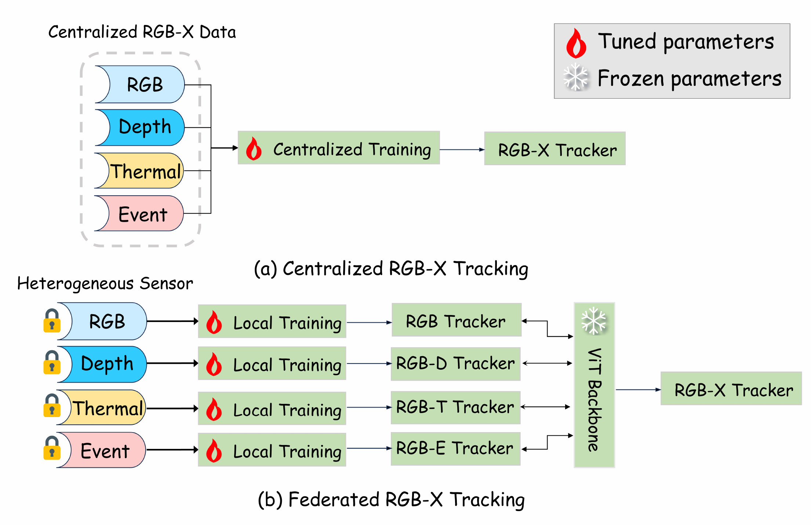

*Motivation of federated RGB-X tracking. (a) Centralized RGB-X tracking pools aligned data from all sensors for one training run. (b) In the federated setting, clients with different sensors (RGB, depth, thermal, event) train locally, and only the tuned prompt parameters are aggregated on top of a frozen ViT backbone.*

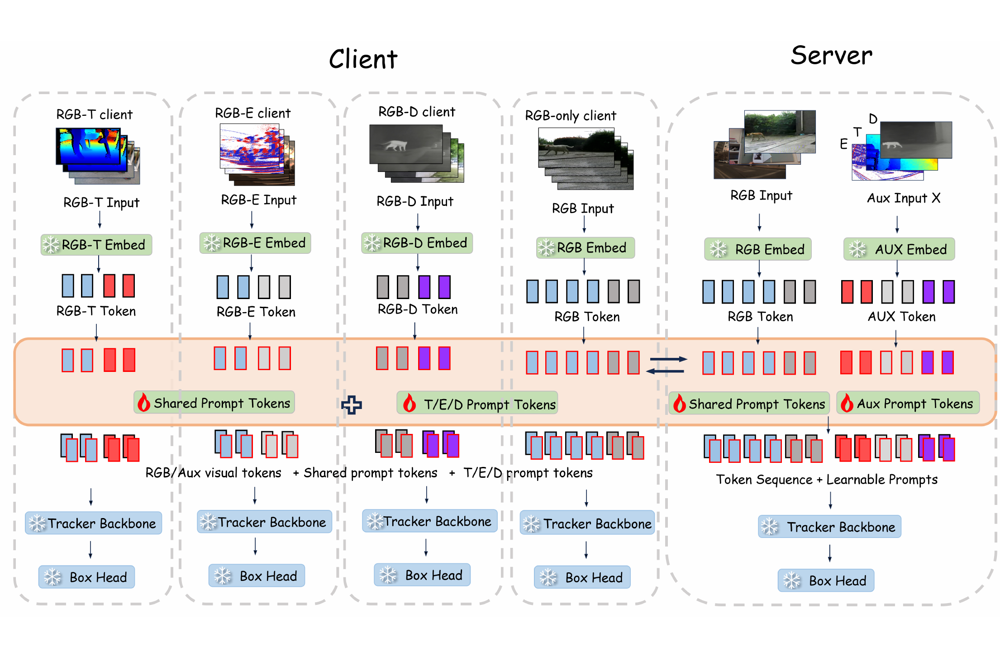

*Overall framework of Fed-MAPTrack. Clients keep training videos local and adapt prompt-related parameters on a frozen tracking backbone and prediction head. RGB-shared parameters use one global bank, while auxiliary-specific, fusion, and normalization parameters use modality banks. Server aggregation combines this sharing structure with sensor-dependent contributor eligibility.*

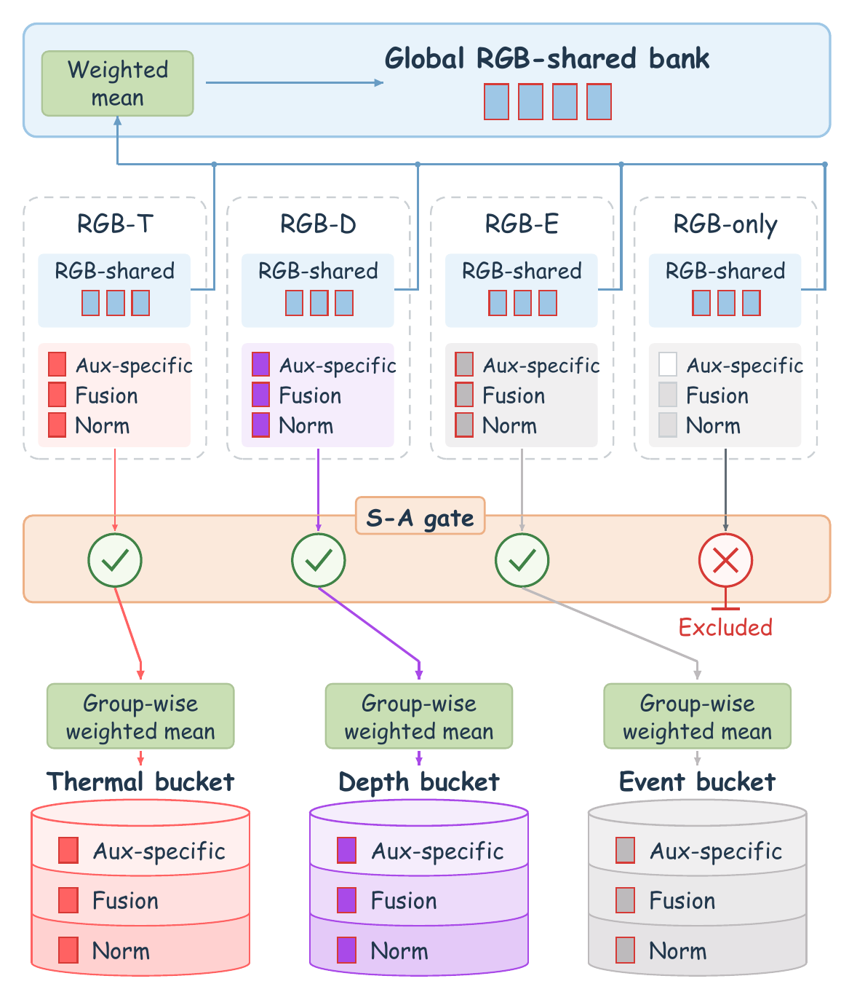

*Unified aggregation design. RGB-shared parameters use the global bank, while auxiliary-specific, fusion, and normalization parameters use thermal, depth, and event banks. The participation gate retains valid RGB updates from RGB-only clients but excludes their modality-related contributions from server bucket averages. Dispatch and local trainability are distinct from server eligibility.*

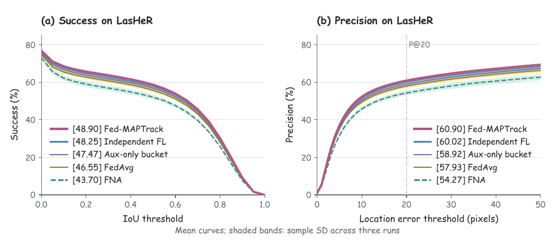

*Success and precision curves on LasHeR at communication round 120 using the same 245 test sequences. Curves show means across three training repetitions, and shaded bands indicate sample standard deviations. Legend values are success AUC in (a) and precision at a 20-pixel threshold in (b), expressed as percentages. Auxiliary-only bucketing and FNA are included as controlled aggregation variants.*

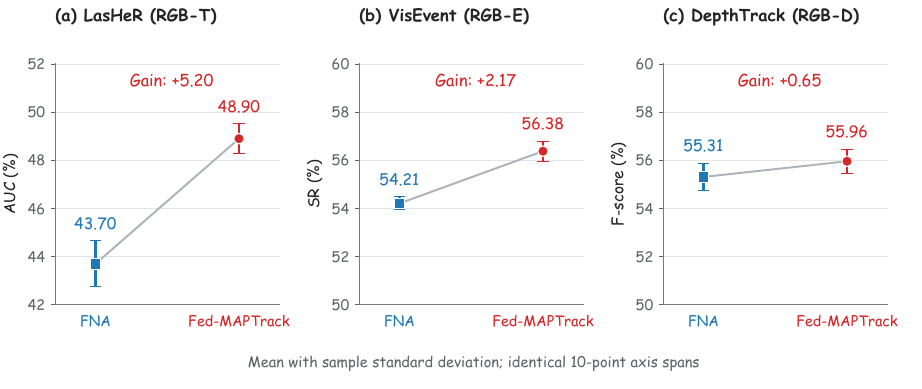

*Effect of selective participation with the parameter-group bucketing scope held fixed. Blue squares and red circles show the mean scores of FNA and Fed-MAPTrack, respectively; error bars indicate sample standard deviations over three training repetitions. The mean gains are 5.20 AUC points on LasHeR, 2.17 SR points on VisEvent, and 0.65 F-score points on DepthTrack. Each vertical axis spans ten percentage points. Connecting lines indicate changes between aggregate means, rather than individual-run trajectories.*

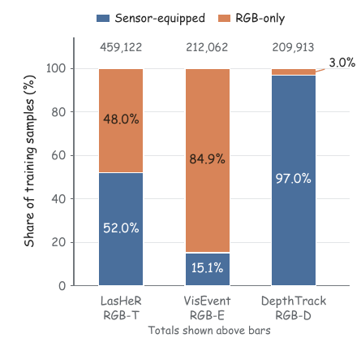

*Training-sample composition of sensor-equipped and RGB-only clients under the evaluated partition. Totals are shown above the bars. RGB-only samples account for 48.0%, 84.9%, and 3.0% of LasHeR, VisEvent, and DepthTrack, respectively. Each benchmark has three sensor-equipped clients and one RGB-only client; the bars describe data proportions rather than client-count proportions.*

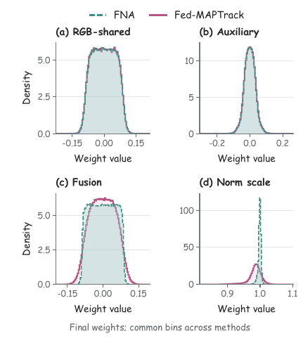

*Empirical final weight distributions of FNA and Fed-MAPTrack at communication round 120. RGB-shared weights use the global bank; the other groups pool the three active modality banks. Curves average three per-run densities using common histogram bins covering the full observed range. Biases, scalar fovea parameters, stored initial banks, and inactive global modality banks are excluded. Panel (d) shows normalization scale weights. These are final-state distributions, not changes from initialization.*

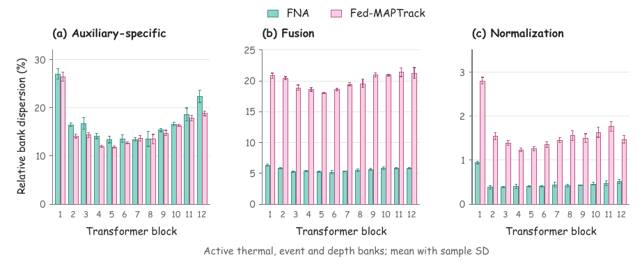

*Layer-wise separation of final thermal, event, and depth parameter banks, measured by the relative dispersion in the paper. All parameters, including biases, are included within each group and Transformer block. Bars and error bars show the mean and sample standard deviation across three training repetitions. The RGB-shared group has only one bank and is omitted. Each panel starts at zero but uses its own labeled range. The statistic describes final bank separation, not tracking accuracy or changes from initialization.*

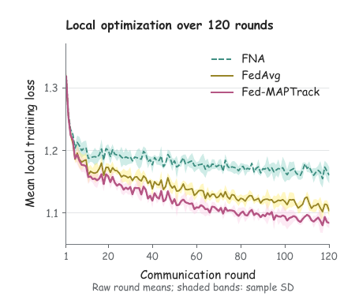

*Recorded local training loss over 120 communication rounds. Within each repetition, the twelve clients' mean local losses are averaged equally in each round. Curves and shaded bands then show the mean and sample standard deviation across three repetitions. All recorded rounds are plotted without smoothing or interpolation. The figure describes local optimization, not intermediate-round benchmark performance.*

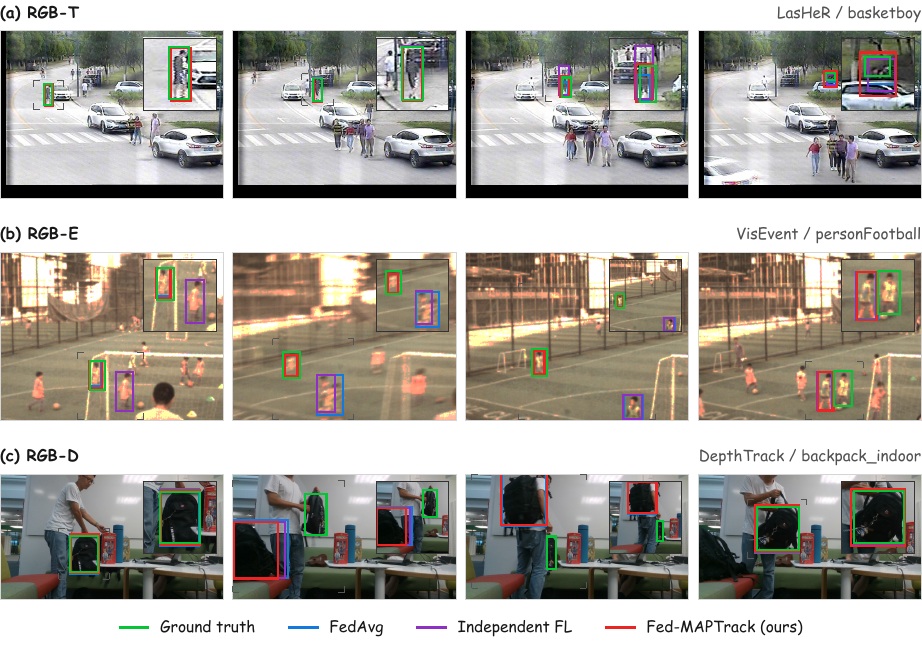

*Qualitative RGB-X tracking comparisons on (a) LasHeR, (b) VisEvent, and (c) DepthTrack. Green, blue, purple, and red solid boxes indicate ground truth, FedAvg, Independent FL, and Fed-MAPTrack, respectively. Each row shows temporally ordered frames from one sequence. Insets magnify a common region containing all displayed predictions and the ground truth; gray corner markers identify these regions in the full images. The examples include both accurate localization and tracking failures.*

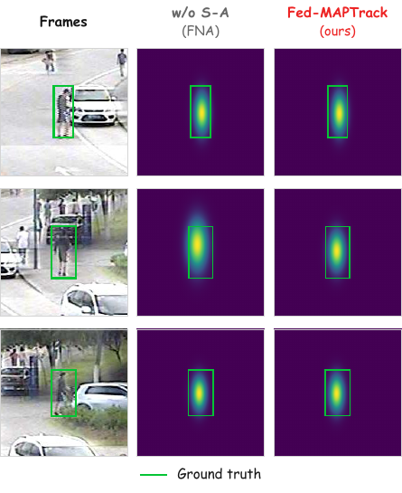

*Box-derived localization comparison between FNA and Fed-MAPTrack on basketboy. The first column shows reference RGB crops; the remaining columns encode saved predicted boxes using the same elliptical Gaussian centered at each predicted box center, with standard deviations equal to one quarter of the predicted width and height. Green boxes indicate ground truth in the common crop coordinates. The maps visualize bounding-box location and extent, rather than internal model attention or confidence.*
